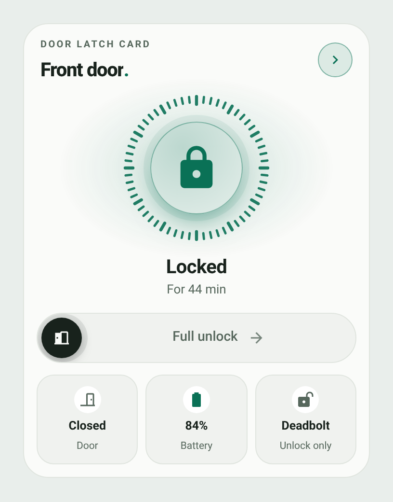
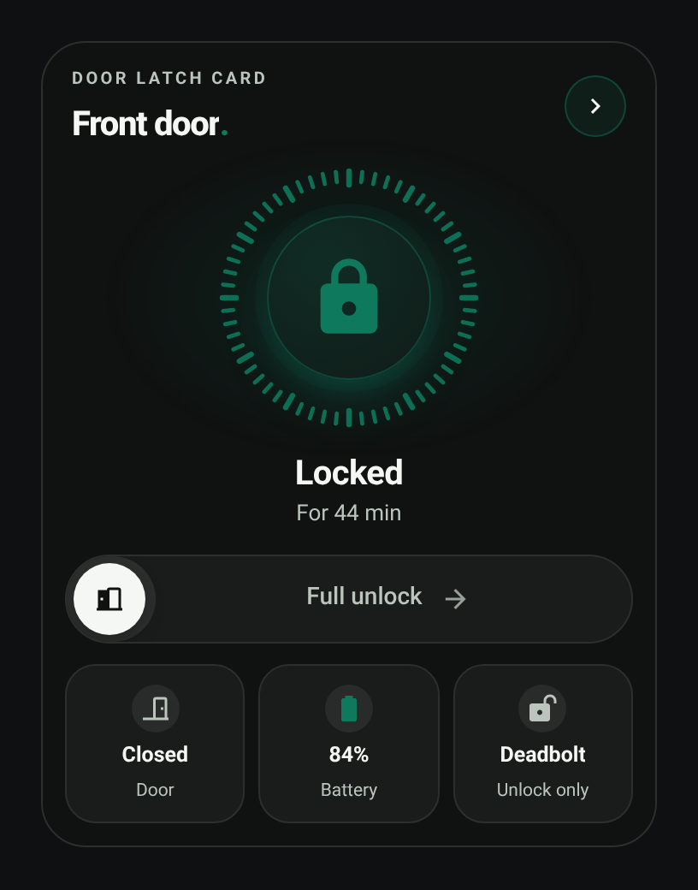
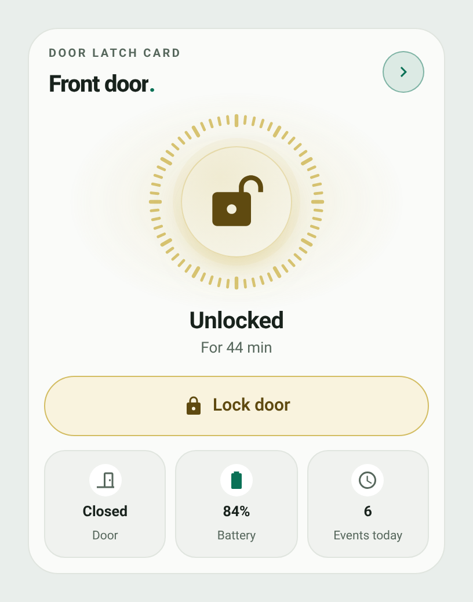
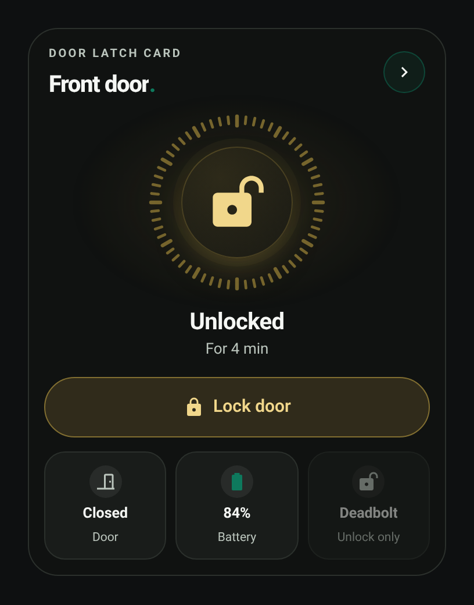
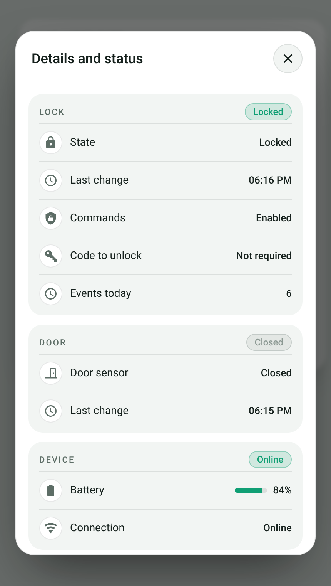
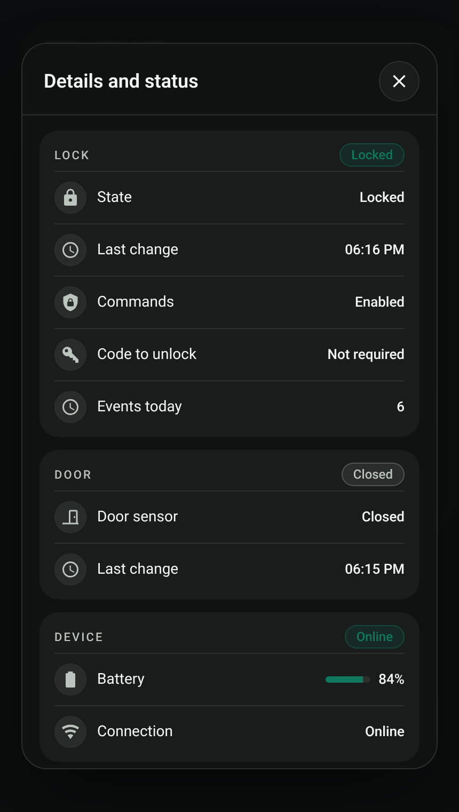

# Door Latch Card

## Overview

**Door Latch Card** is a custom Home Assistant card to unlock and lock a door with a `lock` entity, designed with a minimalist, responsive interface inspired by the Edera Light and Dark visual styles.

A large animated dial shows the state of the lock at a glance: green when locked, amber when unlocked, red when jammed and grey when unavailable. Below it you slide to unlock, and a button locks the door again. Three tiles summarise the door contact, the battery and the number of lock events today. The details popup lists the lock, the door, the device and the latest events.

The card works with any lock integration that provides a `lock` entity, and it does not require a dedicated account, paid API, or subscription.

## Preview

  
  

  
  

  
  

*Door Latch Card in Edera Light and Dark modes, locked and unlocked, with its details popup. The previews use demonstration values and do not display private installation data.*

## Features

- **Animated state dial:** A halo and a ring of ticks that follow the state: locked, unlocked, locking, unlocking, jammed or unavailable. The shackle of the padlock opens and closes with the state.
- **Slide to unlock:** Slide the handle to the right to unlock. While the lock is moving the card shows that it is waiting for the confirmation of the lock.
- **Lock button:** When the door is unlocked, an amber **Lock door** button locks it again, as a reminder that the door is still open to the key.
- **Confirmation of the command:** A ring and a badge confirm a command that succeeded, or report one that failed. A command that does not complete is reported instead of staying pending.
- **Optional code keypad:** If your lock asks for a code, unlocking opens a numeric keypad. The code is typed every time, sent to Home Assistant and never stored in the card or in its settings. Locking never asks for a code.
- **Door sensor (optional):** Closed or open, read from a `binary_sensor`. If the door is open while the lock is locked, the card warns you.
- **Battery:** Level with an icon and a colour that depend on the charge, with thresholds you can change.
- **Events today:** The number of lockings and unlockings of today, read from the history of the lock.
- **Lock state sensor (optional):** Show the state from a separate `sensor`, while the commands stay on the lock entity.
- **Details popup:** Opened from the round button next to the title. Fixed-height popup, centred on the screen; on tablets and desktop it uses a wide layout with columns.
- **Languages:** Italian, English, German and French. The language follows the Home Assistant user, or you can choose one in the editor. In Automatic mode, lock states and a few common words are taken from the translations of Home Assistant when available, in any language that Home Assistant supports; every other text is shown in English when the language is not one of the four.
- **Edera appearance:** Automatic, Light, and Dark themes, rounded elements, and native Home Assistant icons.
- **Visual configuration:** Choose entities with the native Home Assistant selectors in the dashboard editor.

Unavailable or unknown entities are always reported as not available and never as in order.

## Installation

### Marketplace (Recommended)

Install Door Latch Card directly from the default Marketplace catalog in Home Assistant 2026.11 or newer.

1. Go to **Settings** > **Marketplace**.
2. The first time, accept the notice about community content.
3. Use **Search** to find **Door Latch Card**.
4. Open the repository page and select **Install**.
5. Check the version in the dialog and select **Install** again to confirm.
6. Reload your browser to load the new resource.
7. Add **Door Latch Card** to your dashboard and configure it using the visual editor.

### Manual installation

1. Download `dist/door-latch-card.js` from this repository.
2. Copy the JavaScript file to the `www` directory of your Home Assistant configuration.
3. In Home Assistant, open **Settings → Dashboards → Resources**.
4. Add `/local/door-latch-card.js` as a **JavaScript module**.
5. Reload the dashboard and add the custom card.

If the `www` directory was newly created, Home Assistant may require a restart before the file is accessible.

## Configuration and Usage

### Visual editor

Open a dashboard in edit mode, add **Door Latch Card**, and configure the available sections:

- **Lock:** The lock entity, an optional sensor for the lock state, whether the commands are enabled and whether unlocking asks for a code.
- **Modules:** The door sensor, the battery and the events of today. For each module, whether it is active, its entity (where it needs one) and its position. For the battery you can set the low and critical thresholds.
- **Appearance:** Header, title, theme, language and a switch for the full available width on tablets and desktop (on by default; switch it off for a narrow, centred card).

The editor uses native Home Assistant entity selectors, filtered by domain and device class.

### The code keypad

The keypad appears when unlocking only if the option is on **and** the lock entity exposes a code format in Home Assistant. The lock decides whether the code is correct. If the code is refused, the keypad reports it and nothing is unlocked. Locking never asks for a code.

If your lock does not use codes, leave the option off.

### Events today

The number counts the lockings and unlockings recorded today in the history of the lock entity. Short interruptions such as an unavailable state are not counted as events.

## Compatibility and Requirements

Door Latch Card requires:

- Home Assistant with support for custom JavaScript dashboard cards.
- A `lock` entity.
- The history of the lock entity (the Home Assistant recorder) for the events of today. Without it, the tile shows a dash.

Supported entity types: `lock`, `sensor` (lock state, battery) and `binary_sensor` (door, window, opening).

The card uses the standard Home Assistant services `lock.lock` and `lock.unlock`.

No specific minimum Home Assistant version has been independently verified for this repository.

The card does not require a dedicated paid service or additional remote JavaScript libraries.

## Privacy and Security

Door Latch Card operates through Home Assistant entities and the permissions of the authenticated user.

- Commands are sent only when you slide, tap a button or confirm on the keypad.
- A lock code is never stored in the card, in its settings or in the browser.
- The card does not include advertising, analytics, telemetry, or user-tracking services.

**Door Latch Card is not a certified safety, intrusion detection or access control system.** What it shows only reflects the state reported by your entities.

Unknown, unavailable, or missing information must not be interpreted as confirmation that a door is locked or closed.

## Copyright & License

Copyright © 2026 luigi-regolo.

Original project created and maintained by **luigi-regolo**.

Licensed under the **GNU General Public License version 3 only (GPL-3.0-only)**.

See the [LICENSE](LICENSE) file for the complete license terms.

The software is provided without warranty to the extent permitted by applicable law.
